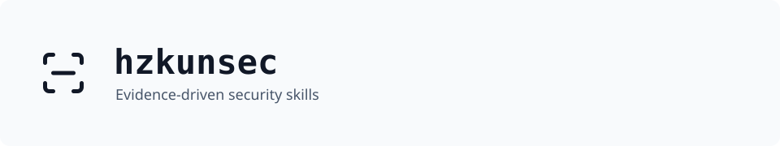
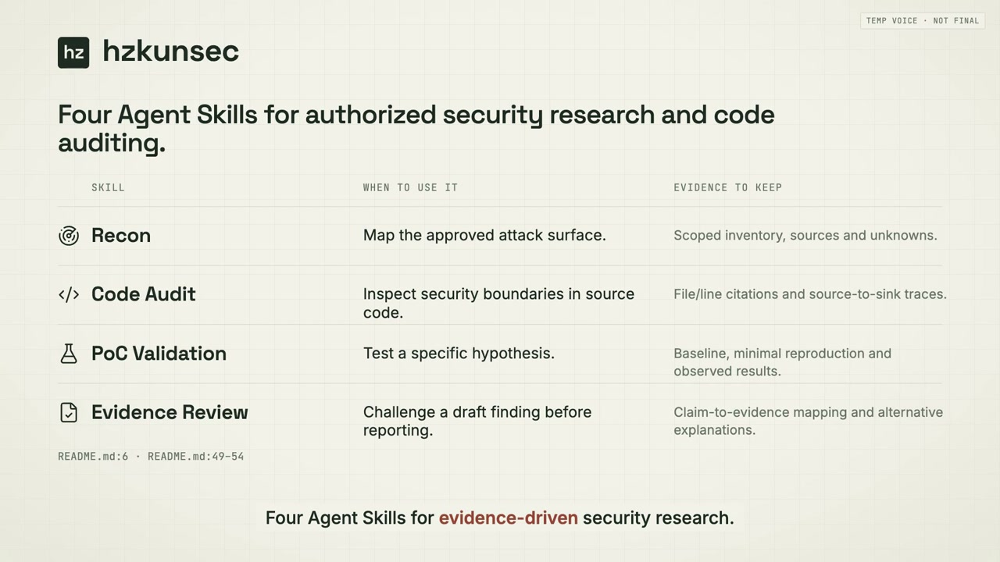

<p align="center">
  
</p>

<p align="center">
  Four Agent Skills for authorized security research and code auditing.<br>
  Trace the evidence, test the hypothesis, review the claim.
</p>

<p align="center">
  <a href="https://github.com/Hzkun001/hzkunsec/actions/workflows/validate.yml"></a>
  <a href="LICENSE"></a>
</p>

<p align="center">
  <a href="#project-overview">Overview</a> ·
  <a href="#quick-start">Quick start</a> ·
  <a href="#skills">Skills</a> ·
  <a href="#workflow">Workflow</a> ·
  <a href="#agent-harnesses">Agent harnesses</a> ·
  <a href="#documentation">Documentation</a>
</p>

## Project overview

A one-minute introduction to the four skills and how they connect claims to evidence.

<p align="center">
  <a href="https://raw.githubusercontent.com/Hzkun001/hzkunsec/main/assets/video/hzkunsec-overview.mp4">
    
  </a>
</p>

<p align="center">
  <a href="https://raw.githubusercontent.com/Hzkun001/hzkunsec/main/assets/video/hzkunsec-overview.mp4"><strong>Download overview ↓</strong></a> · 1:01 · MP4 · 4.1 MB
</p>

Click the preview to download the full MP4. Preview narration; the video illustrates a fictional local investigation. For installation commands, see [Quick start](#quick-start).

## Quick start

Clone and validate with Git, Node.js 24.12+ (with npm) and a POSIX shell (macOS/Linux, WSL or Git Bash):

```bash
git clone https://github.com/Hzkun001/hzkunsec.git
cd hzkunsec
npm ci
npm run validate
```

Choose your [agent harness](#agent-harnesses) below to install the skills and use its invocation syntax. hzkunsec supplies Markdown workflows; the harness provides the model and tools.

Then give the agent a bounded task:

```text
Use code-audit to review authentication in this authorized local repository.
Trace untrusted input to sensitive operations and cite file paths and lines.
Record missing evidence and alternative explanations. Do not run live tests.
Keep findings as hypotheses until reproducible evidence supports the impact.
```

A useful report includes the source-to-sink trace, evidence references, validation status and what remains untested. See the [fictional investigation](examples/investigation-example.md) for an example of a claim that still needs validation.

## Skills

| Skill | When to use it | Evidence to keep |
| --- | --- | --- |
|  [Recon](skills/recon/SKILL.md) | Map the approved attack surface. | Scoped inventory, sources and unknowns. |
|  [Code Audit](skills/code-audit/SKILL.md) | Inspect security boundaries in source code. | File/line citations and source-to-sink traces. |
|  [PoC Validation](skills/poc-validation/SKILL.md) | Test a specific hypothesis. | Baseline, minimal reproduction and observed results. |
|  [Evidence Review](skills/evidence-review/SKILL.md) | Challenge a draft finding before reporting. | Claim-to-evidence mapping and alternative explanations. |

## Workflow

**No Evidence, No Finding. No Verification, No Completion.**

Select the skill for the current question; the sequence below is a possible investigation path, not an automatic pipeline.

```text
Recon → Code Audit → PoC Validation → Evidence Review
```

Every skill uses the same contract: Input → Preconditions → Steps → Evidence → Verification → Exit Criteria.

| Status | Meaning |
| --- | --- |
| `HYPOTHESIS` | A plausible claim that still needs evidence. |
| `NEEDS_VALIDATION` | Evidence is incomplete or reproduction is unresolved. |
| `CONFIRMED` | Reproducible evidence supports the precise claimed impact. |
| `REJECTED` | The claim is not supported by the reviewed evidence. |

Scanner alerts and model agreement are not proof. Keep scope and final decisions under human oversight. Obtain operator approval before intrusive or state-changing tests, and store target details and secrets outside this repository. See the [security policy](SECURITY.md).

## Agent harnesses

These commands install skills into an existing harness. Run global installation commands from the hzkunsec checkout. Choose one installation location per harness and check for same-named skills before copying; `cp -R` can overwrite them.

Examples use `code-audit`. Replace it with `recon`, `poc-validation`, or `evidence-review` as needed. Enter invocation examples in the **agent's chat**, not your shell. Install all four to make them discoverable; load one relevant skill at a time.

| Harness | Project directory | Invocation |
| --- | --- | --- |
| Codex | `.agents/skills/` | `$code-audit` |
| Claude Code | `.claude/skills/` | `/code-audit` |
| Antigravity | `.agents/skills/` | Mention `code-audit`; App/CLI also support `/code-audit` |
| OpenCode | `.opencode/skills/` | Ask it to load `code-audit` with the skill tool |
| Oh My Pi (OMP) | `.omp/skills/` | `/skill:code-audit` |
| Pi | `.agents/skills/` | `/skill:code-audit` |
| Cursor | `.cursor/skills/` | Type `/` and select `code-audit` |
| GitHub Copilot | `.github/skills/` | Ask it to use `code-audit` in agent mode |

<details>
<summary>Codex</summary>

Install for your user:

```bash
mkdir -p ~/.agents/skills
cp -R skills/* ~/.agents/skills/
```

Invoke in Codex CLI or the IDE extension:

```text
$code-audit Review this authorized local project's authentication boundary. Record source-to-sink evidence and unresolved questions.
```

Use `/skills` or the `$` selector to find the skill. In a desktop interface with an `@` skill picker, select `code-audit` there, or explicitly ask to use it. If discovery does not refresh, restart the session.

[Official documentation](https://learn.chatgpt.com/docs/build-skills)

</details>

<details>
<summary>Claude Code</summary>

Install for your user:

```bash
mkdir -p ~/.claude/skills
cp -R skills/* ~/.claude/skills/
```

Invoke:

```text
/code-audit Review this authorized local project's authentication boundary. Record source-to-sink evidence and unresolved questions.
```

Type `/` to find the skill. Claude can also select it when you explicitly mention its name in a normal prompt.

[Official documentation](https://code.claude.com/docs/en/skills)

</details>

<details>
<summary>Antigravity — App, IDE and CLI</summary>

For the App or standalone IDE, install globally:

```bash
mkdir -p ~/.gemini/config/skills
cp -R skills/* ~/.gemini/config/skills/
```

For the CLI, use its separate global directory:

```bash
mkdir -p ~/.gemini/antigravity-cli/skills
cp -R skills/* ~/.gemini/antigravity-cli/skills/
```

Invoke with a normal prompt on any surface:

```text
Use the code-audit skill to review this authorized local project's authentication boundary. Record source-to-sink evidence and unresolved questions.
```

The App and CLI also support `/code-audit`. In the standalone IDE, inspect discovered skills in Customizations. Current versions use `.agents/skills/` for workspace skills; `.agent/skills/` is a legacy compatible location.

[Official documentation](https://www.antigravity.google/docs/skills)

</details>

<details>
<summary>OpenCode</summary>

Install for your user:

```bash
mkdir -p ~/.config/opencode/skills
cp -R skills/* ~/.config/opencode/skills/
```

Invoke with a prompt:

```text
Load the code-audit skill using your skill tool, then review this authorized local project's authentication boundary. Record source-to-sink evidence and unresolved questions.
```

OpenCode 1 loads skills through its `skill` tool; installing a skill does not create a `/code-audit` command. OpenCode 2 also documents `@code-audit` mentions. Use the normal prompt above across versions. Ensure the agent is permitted to use the skill tool.

[OpenCode 1 documentation](https://opencode.ai/docs/skills/) · [OpenCode 2 documentation](https://dev.opencode.ai/v2/docs/skills/)

</details>

<details>
<summary>Oh My Pi (OMP)</summary>

Here, OMP means [Oh My Pi](https://github.com/can1357/oh-my-pi). Use a project-local installation to avoid user-profile directory differences. From the root of the project you want to investigate, replace `/path/to/hzkunsec` with your actual checkout path:

```bash
mkdir -p .omp/skills
cp -R /path/to/hzkunsec/skills/* .omp/skills/
```

Start OMP in that project and invoke:

```text
/skill:code-audit Review this authorized local project's authentication boundary. Record source-to-sink evidence and unresolved questions.
```

If skill commands are disabled, enable `skills.enableSkillCommands` in OMP settings, or ask the agent to read and use `skill://code-audit`.

[Official documentation](https://github.com/can1357/oh-my-pi/blob/main/docs/skills.md)

</details>

<details>
<summary>Pi</summary>

Install for your user using Pi's supported shared Agent Skills directory:

```bash
mkdir -p ~/.agents/skills
cp -R skills/* ~/.agents/skills/
```

If already installed there for Codex, reuse that copy. Start a new Pi session and invoke:

```text
/skill:code-audit Review this authorized local project's authentication boundary. Record source-to-sink evidence and unresolved questions.
```

Pi reads the full skill when invoked. Its `enableSkillCommands` setting controls command discovery in the interactive menu.

[Official documentation](https://github.com/badlogic/pi-mono/blob/main/packages/coding-agent/docs/skills.md)

</details>

<details>
<summary>Cursor</summary>

Install for your user:

```bash
mkdir -p ~/.cursor/skills
cp -R skills/* ~/.cursor/skills/
```

In Agent chat, type `/`, select `code-audit`, and add:

```text
Review this authorized local project's authentication boundary. Record source-to-sink evidence and unresolved questions.
```

Check Customize → Skills for discovery. For remote/cloud agents, use project skills committed to the target repository or configure Cursor's supported sync; local installation alone does not make the skill available remotely.

[Official documentation](https://cursor.com/docs/skills)

</details>

<details>
<summary>GitHub Copilot</summary>

For Copilot CLI, install personal skills:

```bash
mkdir -p ~/.copilot/skills
cp -R skills/* ~/.copilot/skills/
```

For an IDE agent or cloud agent, use the project installation below with `.github/skills/`. Commit project skills to the target repository when the cloud agent needs them.

Invoke in an agent session:

```text
Use the code-audit skill to review this authorized local project's authentication boundary. Record source-to-sink evidence and unresolved questions.
```

In Copilot CLI, you can explicitly mention `/code-audit` in your prompt. Run `/skills reload` after installing, then `/skills info code-audit` to check its path. Support depends on the Copilot surface and version. A personal CLI installation is not automatically available to a cloud agent.

[Official documentation](https://docs.github.com/en/copilot/concepts/customizations/agent-skills) · [CLI setup and invocation](https://docs.github.com/en/copilot/how-tos/copilot-cli/customize-copilot/add-skills)

</details>

### Project-only installation

For a harness in the table, use its project directory instead of the global location. For example, from the **root of the project you want to investigate**:

```bash
mkdir -p .agents/skills
cp -R /path/to/hzkunsec/skills/* .agents/skills/
```

Replace `/path/to/hzkunsec` with your actual checkout path and `.agents/skills` with the harness directory from the table. Do not copy the enclosing `skills` folder: the result must be `<harness-directory>/code-audit/SKILL.md`.

To install only one skill, copy `skills/code-audit` instead of `skills/*`. Keep the checkout available for shared [templates](templates/progress.md) and [methodology](docs/methodology.md); these live outside the individual skill folders. Re-run the copy command after updating this checkout if you want to update installed copies.

### Check discovery

Start a new session in the target project and ask the agent to list the available hzkunsec skills and show the path of the skill it loaded. Confirm that it actually reads `SKILL.md` before following the workflow. If missing, check the destination layout, duplicate names, disabled skill settings and the harness version. These instructions follow upstream documentation checked on 2026-10-24; they are not a claim of end-to-end testing in every harness.

For another harness that supports Agent Skills, follow its documented discovery directory and ask it to use the skill by name. Without native support, ask it to read the checkout's `skills/code-audit/SKILL.md` directly; that is manual instruction loading, not native skill discovery.

## Documentation

| Guide | Covers |
| --- | --- |
| [Methodology](docs/methodology.md) | Investigation steps, approval points and completion criteria. |
| [Ground truth](docs/ground-truth.md) | How to weigh observations, sources and model inference. |
| [Architecture](docs/architecture.md) | Skill selection, harness responsibilities and human oversight. |
| [Response format](docs/response-format.md) | A consistent report structure and explicit uncertainty. |
| [Finding report](templates/finding-report.md) · [Progress template](templates/progress.md) | Reusable records for your private investigation workspace. |

## Contributing

Keep each skill focused, preserve the evidence contract, and run `npm run validate` before submitting a change. See [contributing guidelines](CONTRIBUTING.md), [open issues](https://github.com/Hzkun001/hzkunsec/issues) and the [validation workflow](.github/workflows/validate.yml).

## License

[MIT](LICENSE). Brand lettering uses Space Grotesk ([OFL](assets/LICENSE.space-grotesk)); workflow icons use Lucide ([license](assets/LICENSE.lucide)). [Logo variants and asset sources](assets/README.md).
